# icue-edge-widgets

HTML, CSS, and JavaScript widgets for CORSAIR iCUE on Windows. The collection targets XENEON EDGE dashboards and pump LCD displays. Import the generated `.icuewidget` files into iCUE.

## Requirements

- Windows and iCUE 5.47 or later, as declared in the generated manifests.
- A compatible `dashboard_lcd` or `pump_lcd` device for hardware verification.
- PowerShell 5.1 or later and the iCUE Widget CLI for packaging. Packaging is tested with CLI 0.2.3.
- Node.js for the logic tests; tested with 26.7.0. TODO: establish the minimum supported Node.js version.
- Optional: Python 3 for local previews, and an existing Playwright installation for browser tests (tested with 1.59.1).

## Install

Clone the repository, then build the packages with an already installed Widget CLI:

```powershell
git clone https://github.com/inerthel-agi/icue-edge-widgets.git
cd icue-edge-widgets
powershell -NoProfile -ExecutionPolicy Bypass -File scripts/package-icuewidgets.ps1
```

The script finds `icuewidget` on PATH or under `%LOCALAPPDATA%\Programs\iCUEWidgetCLI\bin`. An explicit path can also be supplied with `-CliPath`.

In iCUE, open the device's Widgets section, choose the add/import control, and select the appropriate file from `dist/icuewidgets/`. See the [official import instructions](https://docs.elgato.com/icue/widgets/#loading-in-icue).

## Usage

| Device folder | Packages |
| --- | --- |
| `dist/icuewidgets/xeneon-edge/` | `iss-horizon`, `weather-now`, `github-repo-monitor`, `world-clock`, `focus-timer`, `daily-brief`, `countdowns`, `habit-rings`, `claude-usage`, `codex-usage`, `ai-cost`, `screen-time`, `agent-activity`, `audio-mixer`, `control-deck`, `stocks`, `network-pulse`, `system-pulse`, `rig-pet`, `flip-clock`, `rain-window`, `now-playing`, `spotify` |
| `dist/icuewidgets/corsair-watercooling/` | `windows-media-pump`, `cooling-sensor-pump`, `racing-gauge-pump`, `fps-gauge-pump` |

Each package name has the `.icuewidget` extension. The widget UI is in English.

Music: use `now-playing`, including for Spotify. It reads the Windows media sessions, so it works with any player, needs no account or Spotify token, and is not subject to Spotify's request limits. `spotify` is an advanced option: it needs your own Spotify app (created on `developer.spotify.com`) and Spotify Premium, and Spotify suspends an app that sends too many requests; the companion then waits for the time Spotify gives, up to 24 hours. `now-playing` shows the Spotify queue only when the companion is connected to Spotify this way.

Screenshots: usage figures, the sensor reading, countdowns and habits are demo values. Weather, GitHub and ISS data are live at capture time. The music is real tracks with their album artwork.

| | |
| --- | --- |
| 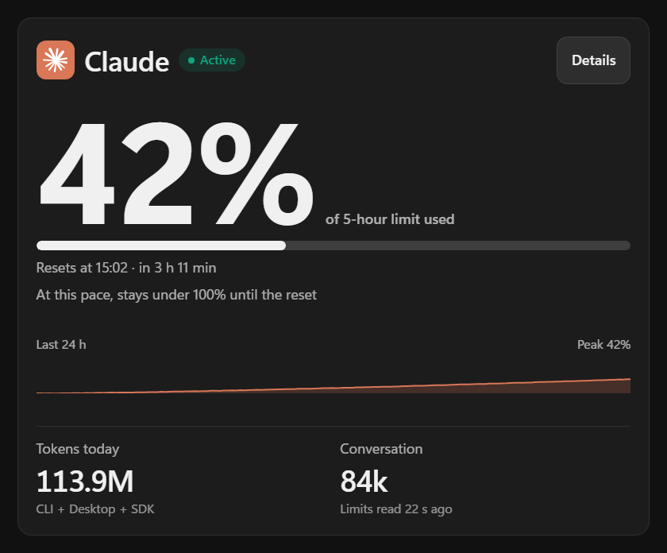<br>Claude Usage, 840 × 696 | 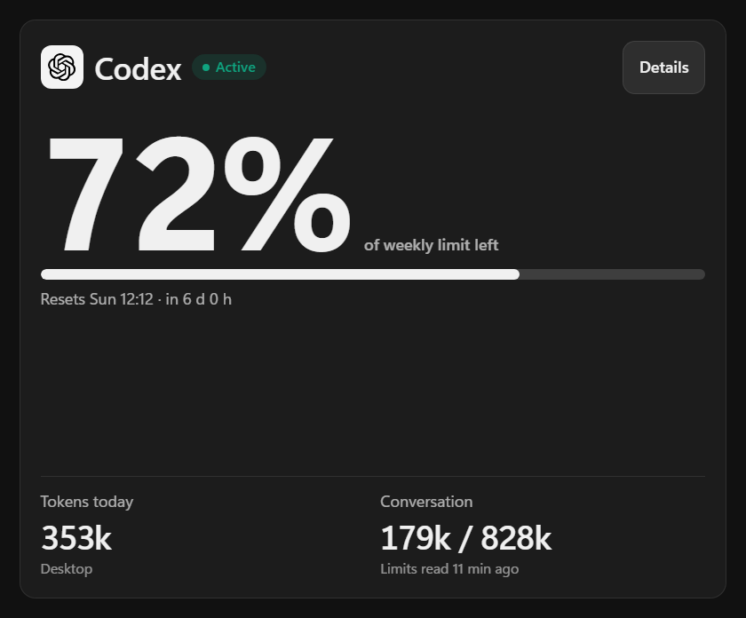<br>Codex Usage, 840 × 696 |
| 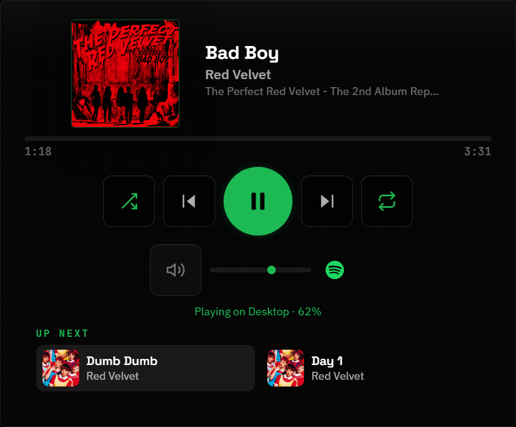<br>Spotify, 840 × 696 | 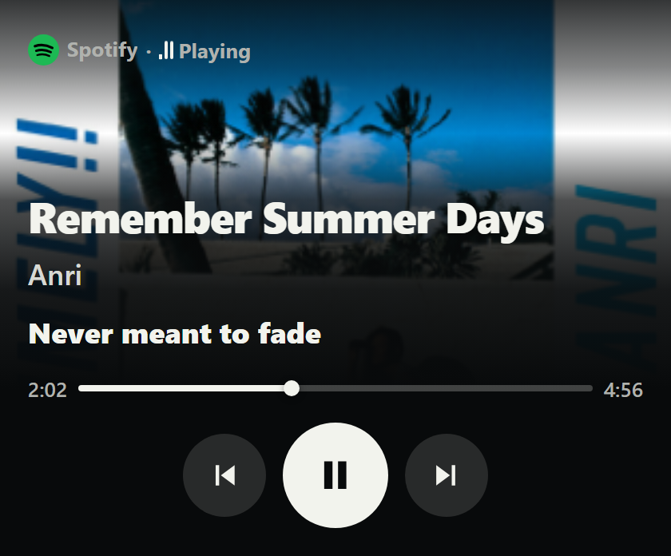<br>Now Playing, 840 × 696 |
| 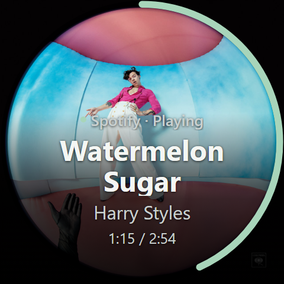<br>Windows Media Pump, pump LCD 480 × 480 | 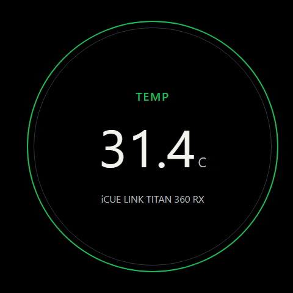<br>Cooling Sensor Pump, pump LCD 480 × 480 |
| 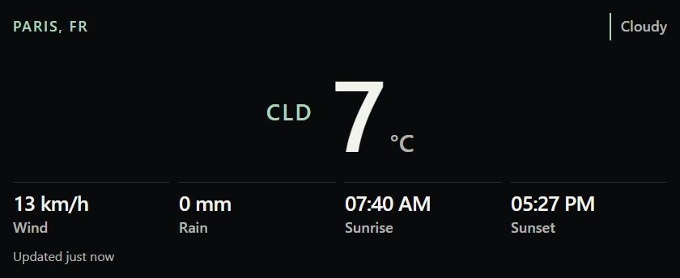<br>Weather Now, 840 × 344 | 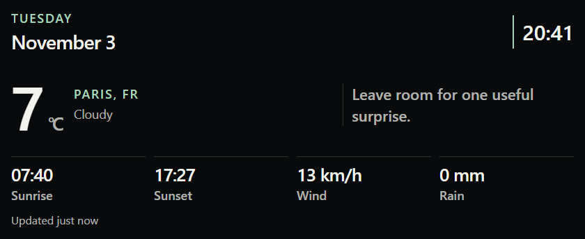<br>Daily Brief, 840 × 344 |
| 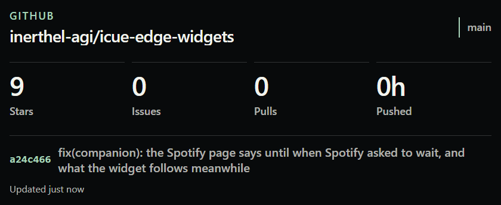<br>GitHub Repo Monitor, 840 × 344 | 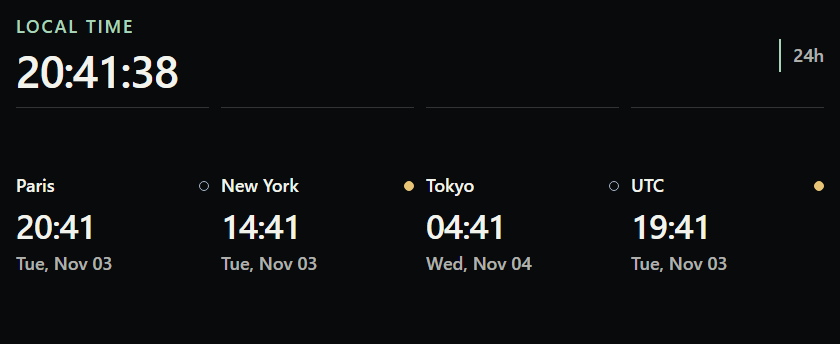<br>World Clock, 840 × 344 |
| 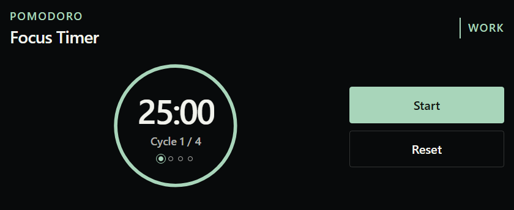<br>Focus Timer, 840 × 344 | 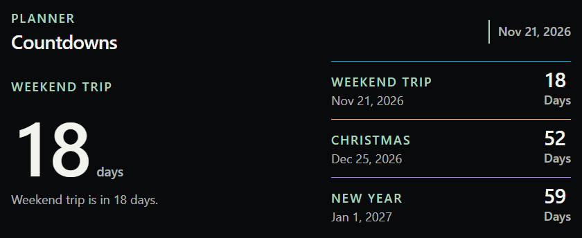<br>Countdowns, 840 × 344 |
| 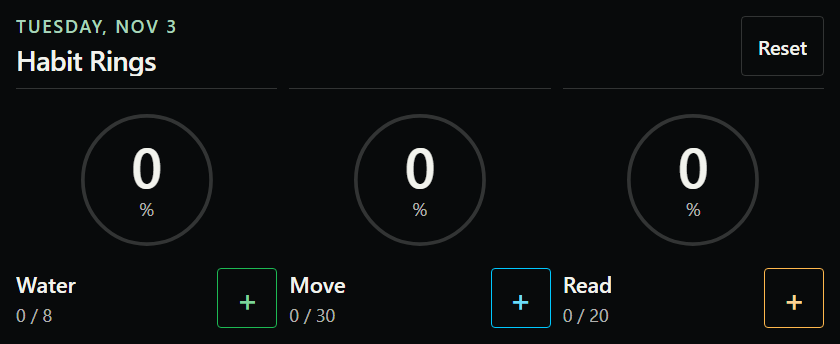<br>Habit Rings, 840 × 344 | 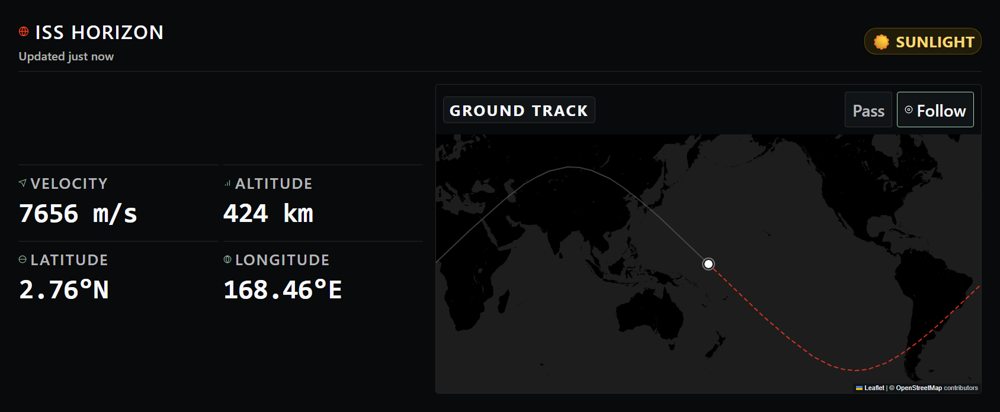<br>ISS Horizon, 1688 × 696 |

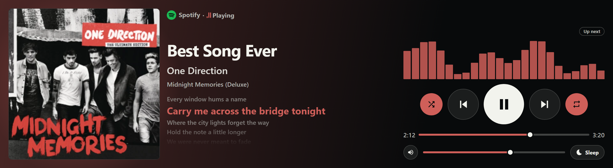<br>Now Playing, 2536 × 696: player mark, cover colours, synced lyrics (tap a line to seek), shuffle and repeat, visualiser (tap the area for `Up next`, Spotify only), volume and sleep timer. Everything except the player mark and the cover colours needs iCUE Edge Companion 0.1.4 or later. The lyrics, the bars and the queue in this capture are invented.

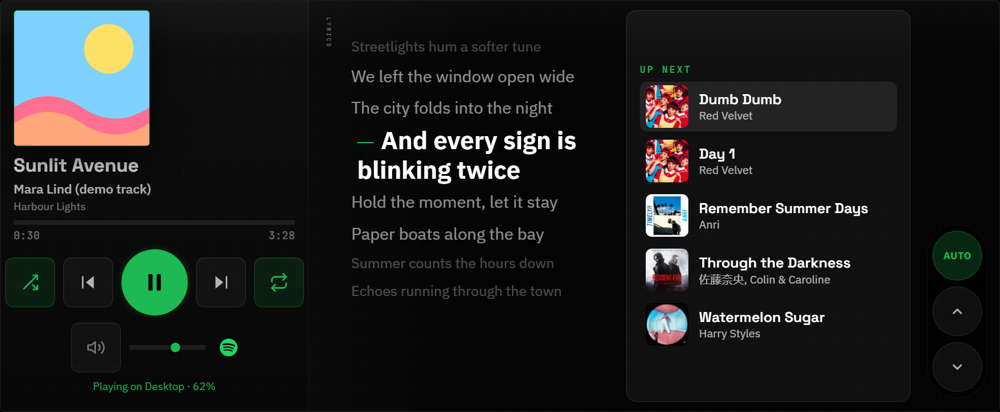

Spotify (advanced option), 1688 × 696, with synced lyrics and `Up next` (tap a track to skip to it; needs iCUE Edge Companion 0.1.4 or later). The track and its lyrics are invented for the demo; real lyrics come from LRCLIB at run time.


Twelve widgets read their data from [iCUE Edge Companion](https://github.com/inerthel-agi/icue-edge-companion), a Windows tray application that must run on the same computer. Download it from its [releases page](https://github.com/inerthel-agi/icue-edge-companion/releases). The other fifteen work on their own; `system-pulse` and `rig-pet` read the iCUE Sensors plugin and `rain-window` reads Open-Meteo.

| Widget | Without the companion |
| --- | --- |
| `claude-usage`, `codex-usage` | No data. The widget shows `iCUE Edge Companion is unreachable. Retrying automatically.` |
| `ai-cost` | `Companion offline` until it answers; then it keeps the last figures and says `Offline`. The dollar figure is an estimate from token counts and the price class chosen in iCUE, not a bill |
| `audio-mixer` | `Companion offline`; with it, one fader and mute per app playing sound and one for the output device (tap an icon to mute) |
| `agent-activity` | `Companion offline`, or `Claude Code not detected`; shows tool and file names only, never prompts or file contents |
| `stocks` | `Companion offline` until it answers, then the last quotes with a note; quotes come from Yahoo Finance (unofficial, can be delayed), only the symbols you set are sent |
| `network-pulse` | `Companion offline`; with it, the adapters' byte counters (no traffic is read) and one ping every 3 s at most to the resolver chosen in iCUE (`Off` sends none) |
| `control-deck` | `Companion offline`; ten fixed actions, a red key is a muted microphone or sound |
| `screen-time` | `Companion offline`. Counting starts when the widget first asks the companion (application names and times only, kept on this PC) and needs a companion with Screen Time |
| `spotify` | No data. The widget shows `Companion not running`. Spotify Premium is connected in the companion, never in iCUE |
| `now-playing` | After 8 s, title and artist only from the iCUE Media plugin, labelled `Native mode` |
| `windows-media-pump` | Same fallback: title and artist only, no artwork or progress |

Repository layout:

| Folder | Content |
| --- | --- |
| `widgets/xeneon-edge/<name>/` | Source of each XENEON EDGE widget |
| `widgets/pump/<name>/` | Source of each pump LCD widget |
| `shared/` | `widget-runtime.js`, `xeneon-widget.css`, `widget-polish.css`, linked by widgets as `../../../shared/<file>` and copied into a package only when linked |
| `icons/` | Widget icons, one SVG per package |
| `previews/` | Simulated browser previews (`media-player-preview`, `pump-media-preview`, `spotify-preview`); they never reach a real app |
| `drafts/` | Unpackaged drafts |
| `scripts/`, `tests/` | Packaging script and tests |
| `dist/icuewidgets/` | Generated packages |
| `docs/screenshots/` | README screenshots |

XENEON EDGE layouts use labels of at least 18 px, status text of at least 16 px, and primary touch controls of at least 60 × 60 px. Compact layouts rearrange content to keep the larger text readable. Pump LCD layouts retain their separate sizing.

Network widgets show when data was last received and when a delayed retry is due. Daily Brief keeps its clock visible when the weather is unavailable.

In ISS Horizon, tap/click a location to estimate a nearby pass. Alternatively, focus the map, pan with the arrow keys, and activate **Pass** to use the map center. Dragging or keyboard panning pauses **Follow**; activate it to resume tracking. Estimates require an ISS position received within the last 30 seconds.

For a local preview, run this from the repository root:

```powershell
python -m http.server 8080 --bind 127.0.0.1
```

Open `http://127.0.0.1:8080/widgets/xeneon-edge/focus-timer/` or another widget directory. Native sensors and media require iCUE; a regular browser shows the unavailable state.

Run the dependency-free logic tests, the isolated packaging failure tests and, if Playwright is already resolvable by Node.js, the browser tests:

```powershell
node --test tests/widgets.test.cjs
powershell -NoProfile -ExecutionPolicy Bypass -File tests/packaging.test.ps1
node tests/ui-smoke.cjs
```

The browser script also accepts the absolute path of an existing Playwright module as its first argument and a browser executable as its second. It uses fixture API/plugin responses, fetches the pinned Leaflet library, and writes screenshots to a temporary directory. Map tiles are mocked during automated size checks.

## Configuration

Configure widget properties in iCUE. Existing property names and manifest IDs are retained across this update.

| Widget | Properties | Defaults / effect |
| --- | --- | --- |
| ISS Horizon | `issMapStyle` | `dark`; also `day`, `satellite`, `auto` |
| Weather Now | `weatherCity`, `weatherUnits` | `Paris`, `celsius`; units also accept `fahrenheit` |
| Daily Brief | `briefCity`, `briefUnits`, `briefFormat` | `Paris`, `celsius`, `24h` |
| GitHub Repo Monitor | `githubRepo`, `githubToken` | `inerthel-agi/icue-edge-widgets`, empty optional token |
| World Clock | `clockTz1` through `clockTz4`, `clockFormat` | Paris, New York, Tokyo, UTC; `24h` |
| Focus Timer | `focusWork`, `focusBreak`, `focusLong`, `focusCycles` | 25, 5, 15 minutes; 4 cycles |
| Countdowns | `countdown1Label/Date/Color` through `countdown3Label/Date/Color` | Three named dates; date input is `YYYY-MM-DD` |
| Habit Rings | `habit1Label/Goal` through `habit3Label/Goal` | Water/8, Move/30, Read/20 |
| Cooling Sensor Pump | `coolingAuto`, `coolingSensor` | Automatic selection is on by default; disable it to use the native manual sensor selector. An unavailable manual sensor is not replaced automatically. |
| Windows Media Pump | None | Reads the Media plugin's current title and artist |

Packaging options:

| Parameter / file | Type | Default | Effect |
| --- | --- | --- | --- |
| `-CliPath` | string | Automatic discovery | Select the installed Widget CLI |
| `-Version` | string | Contents of `VERSION` | Set a stable `x.y.z` package version for this build |
| `VERSION` | text file | `1.2.1` | Shared version for all twenty-two packages |

The builder stages files in a unique `icuewidget-build/` directory. It checks the HTML head, property groups, local asset references, CLI validation, and archive contents before replacing the output directory. A failed promotion restores the previous output when the destination is available. Previous packages remain in `icuewidget-build/previous-*`; this folder is ignored by Git. Concurrent builds are rejected while the packaging lock is held.

Saved timer state, habit counts, and ISS settings/cache are stored under iCUE's `uniqueId`, with separate widget namespaces. Browser previews use a per-widget fallback key. Legacy records are copied when needed and retained; unrelated properties in the same record are preserved.

## Limitations

- Browser tests do not certify physical display behavior, iCUE import, or native plugin behavior on every device.
- CLI 0.2.3 warns that `index.html` does not declare `icueEvents`; the event declarations are in external scripts to preserve the existing Content Security Policy.
- ISS dark/day maps use OpenStreetMap tiles with local grayscale styling; no map key is needed. Satellite maps use Esri. Internet access and provider availability are required; attribution remains visible. Follow the [OSM tile policy](https://operations.osmfoundation.org/policies/tiles/); there is no tile prefetch or offline tile download feature.
- ISS tracking uses Where the ISS At. Pass estimates search for the first nearby ground-track approach within 500 km over three days using a simplified orbital model. They do not predict visibility or provide precise observation times.
- Leaflet is loaded from its pinned CDN URL. First-load map rendering needs that CDN.
- Weather uses Open-Meteo geocoding and forecast services. Requests time out after 12 seconds; retries back off and respect server retry delays. Last successful readings are explicitly marked offline after a failed refresh.
- GitHub counts scan at most 1,000 open items. Larger repositories display lower bounds with `≥`; API quotas can pause updates.
- Legacy running timers resume their last saved duration because old records do not contain a reliable elapsed-time snapshot. Invalid stored records are retained rather than overwritten; saving remains unavailable until the record is repaired.
- The two local drafts `drafts/network-pulse` and `drafts/system-status-local` are not packaged. They require a separate service at `127.0.0.1:8787/system/status` that is not included here.
- Widget source copying currently supports flat HTML, JavaScript, CSS, SVG, and PNG files. Missing or out-of-package references fail preflight.

## License

Apache-2.0. See [LICENSE](LICENSE). External map services and libraries retain their own terms and attribution requirements.

The `rig-pet` mascot Jennie (`widgets/xeneon-edge/rig-pet/pet-jennie.webp`) is unofficial, non-commercial fan art drawn by the author. It has no affiliation with the person it depicts and is not endorsed by her or her agency.

The `rig-pet` mascot Claire (`widgets/xeneon-edge/rig-pet/pet-claire.webp`) is unofficial, non-commercial fan art of Claire Redfield from Capcom's Resident Evil series, made by the author. Resident Evil and its characters belong to Capcom.

The following `rig-pet` mascots are community Codex pets from [codex-pet.org](https://codex-pet.org/). The site states no license for them. Each is unofficial fan art of the subject named below, with no affiliation or endorsement. Characters, names and trademarks belong to their owners. They are included for non-commercial use and will be removed on request from the creator or the rights holder.

| Mascot | File in `widgets/xeneon-edge/rig-pet/` | Creator | Depicts |
|---|---|---|---|
| [Dario](https://codex-pet.org/pets/dario/) | `pet-dario.webp` | `user-6bb09cf5` | Dario Amodei (Anthropic CEO) |
| [Tom](https://codex-pet.org/pets/tom/) | `pet-tom.webp` | `antony` | Tom (Tom and Jerry) |
| [Patrick](https://codex-pet.org/pets/palantir-patrick/) | `pet-patrick.webp` | `jb` | Patrick Star (SpongeBob SquarePants) |
| [Pepe](https://codex-pet.org/pets/apupepe/) | `pet-pepe.webp` | `kegashin` | Pepe the Frog |
| [Rick](https://codex-pet.org/pets/rick/) | `pet-rick.webp` | `kidolata` | Rick Sanchez (Rick and Morty) |
| [Doge](https://codex-pet.org/pets/doge/) | `pet-doge.webp` | `seymour` | the Doge meme |
| [Mini Elon](https://codex-pet.org/pets/mini-elon/) | `pet-elon.webp` | `nico` | Elon Musk |
| [Kirby](https://codex-pet.org/pets/kirby/) | `pet-kirby.webp` | `kirby_king` | Kirby (Nintendo) |
| [Clippy](https://codex-pet.org/pets/clippit/) | `pet-clippy.webp` | `Dimava` | Clippy (Microsoft Office) |
| [Tux](https://codex-pet.org/pets/tuxterm/) | `pet-tux.webp` | `chochou` | Tux, the Linux mascot (Larry Ewing) |
| [Frieren](https://codex-pet.org/pets/frieren/) | `pet-frieren.webp` | `rudoduro` | Frieren (Frieren: Beyond Journey's End) |
| [Anya](https://codex-pet.org/pets/anya/) | `pet-anya.webp` | `Delk` | Anya Forger (Spy x Family) |
| [Miku](https://codex-pet.org/pets/miku/) | `pet-miku.webp` | `tune` | Hatsune Miku (Crypton Future Media) |
| [Luffy](https://codex-pet.org/pets/luffy-gear-5/) | `pet-luffy.webp` | `jordsshmords1` | Monkey D. Luffy (One Piece) |
| [Goku](https://codex-pet.org/pets/goku/) | `pet-goku.webp` | `hackminit` | Son Goku (Dragon Ball) |
| [Gojo](https://codex-pet.org/pets/gojo/) | `pet-gojo.webp` | `lilokhalikfa` | Satoru Gojo (Jujutsu Kaisen) |
| [Umaru](https://codex-pet.org/pets/umaru/) | `pet-umaru.webp` | `yc` | Umaru Doma (Himouto! Umaru-chan) |
| [Asuka](https://codex-pet.org/pets/asuka/) | `pet-asuka.webp` | `maxg24` | Asuka Langley Soryu (Neon Genesis Evangelion) |
| [Doraemon](https://codex-pet.org/pets/doraemon/) | `pet-doraemon.webp` | `xueshi` | Doraemon (Fujiko F. Fujio) |
| [Elaina](https://codex-pet.org/pets/elaina/) | `pet-elaina.webp` | `Nyakku Shigure` | Elaina (Wandering Witch) |
| [Violet](https://codex-pet.org/pets/violet/) | `pet-violet.webp` | `Lazenca` | Violet Evergarden (Kyoto Animation) |
| [Bocchi](https://codex-pet.org/pets/bocchi/) | `pet-bocchi.webp` | `tune` | Hitori Gotoh (Bocchi the Rock!) |
| [Luo Xiaohei](https://codex-pet.org/pets/luo-xiaohei/) | `pet-xiaohei.webp` | `2003pro` | Luo Xiaohei (The Legend of Luo Xiaohei) |
| [Mini Sama](https://codex-pet.org/pets/mini-sama/) | `pet-sama.webp` | `NotOnKetamine` | Sam Altman (OpenAI CEO) |
| [Doro](https://codex-pet.org/pets/doro/) | `pet-doro.webp` | `chochou` | Doro (fan character from Goddess of Victory: NIKKE) |
| [Guga](https://codex-pet.org/pets/guga/) | `pet-guga.webp` | `CIRCUS` | Guga, a penguin-hoodie girl meme character |
| [Kiki](https://codex-pet.org/pets/kiki/) | `pet-kiki.webp` | `Hessian` | Kiki and Jiji (Kiki's Delivery Service, Studio Ghibli) |
| [Usagi](https://codex-pet.org/pets/usagi/) | `pet-usagi.webp` | `Kenn` | Usagi (Chiikawa, Nagano) |
| [Hachiware](https://codex-pet.org/pets/xiaoba/) | `pet-hachiware.webp` | `Leo` | Hachiware (Chiikawa, Nagano) |
