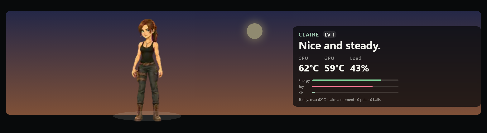
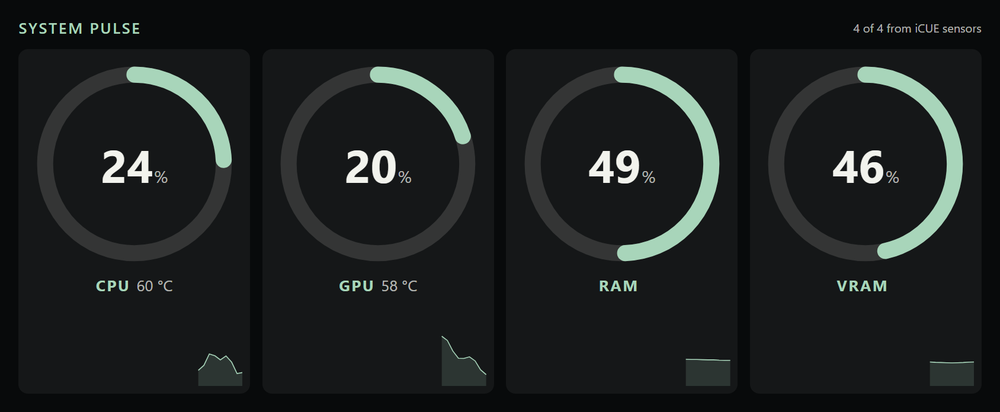
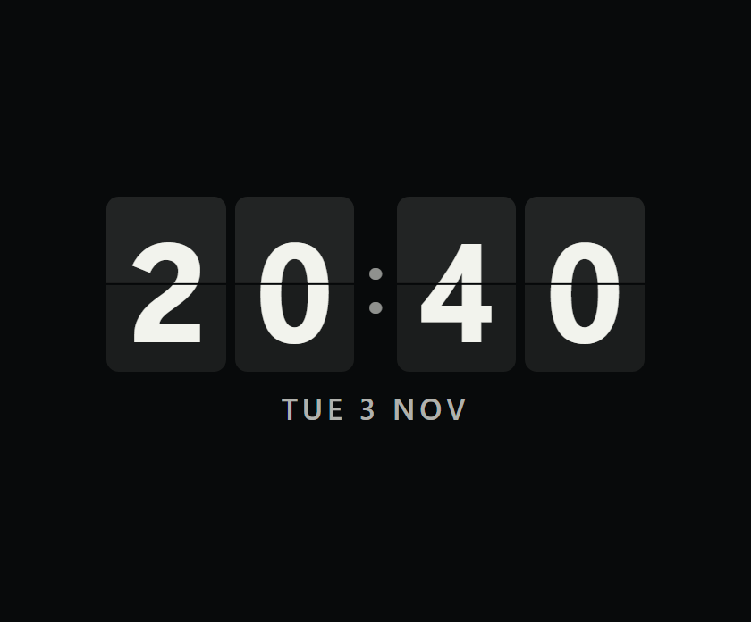
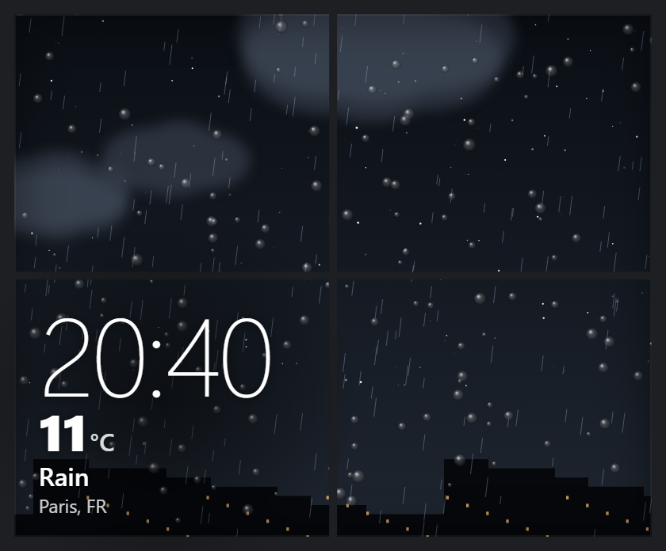

# icue-edge-widgets

Widgets for CORSAIR iCUE on Windows: 29 for the XENEON EDGE touch screen and 5 for pump LCDs, plus [iCUE Edge Companion](companion/README.md), the tray application that feeds sixteen of them with local data (AI usage, music, games, network, mixer, stocks, screen time).



## Requirements

- Windows 10 or 11 and iCUE 5.47 or later.
- A XENEON EDGE (`dashboard_lcd`) or a pump LCD (`pump_lcd`).
- For the sixteen companion widgets: [iCUE Edge Companion](https://github.com/inerthel-agi/icue-edge-widgets/releases) running on the same PC (WebView2 runtime).
- To rebuild the packages: PowerShell 5.1 and the iCUE Widget CLI (tested with 0.2.3). To build the companion: Rust 1.95 or later.

## Install

1. Download the repository, or clone it:

   ```powershell
   git clone https://github.com/inerthel-agi/icue-edge-widgets.git
   ```

2. In iCUE, open the device's Widgets section, choose import, and pick a file from `dist/icuewidgets/xeneon-edge/` or `dist/icuewidgets/corsair-watercooling/`. See the [official import instructions](https://docs.elgato.com/icue/widgets/#loading-in-icue).
3. For a companion widget, download `icue-edge-companion-<version>-windows-x64.exe` from the [releases](https://github.com/inerthel-agi/icue-edge-widgets/releases) and run it. It needs no installation; an icon appears in the notification area. Versions up to 0.1.4 are in the archived [icue-edge-companion](https://github.com/inerthel-agi/icue-edge-companion/releases) repository.

To rebuild from source:

```powershell
powershell -NoProfile -ExecutionPolicy Bypass -File scripts/package-icuewidgets.ps1
cd companion\companion
cargo build --release
```

The packaging script finds `icuewidget` on PATH or under `%LOCALAPPDATA%\Programs\iCUEWidgetCLI\bin`; `-CliPath` sets it explicitly. It validates every package and keeps the previous output in `icuewidget-build/previous-*`.

## Widgets

| Widget | What it shows | Needs |
| --- | --- | --- |
| `rig-pet` | A pet that reacts to CPU and GPU heat, with needs, levels, a room with the real weather and 39 mascots | iCUE Sensors plugin |
| `system-pulse` | CPU, GPU, RAM and VRAM load rings with temperatures and the last minute | iCUE Sensors plugin |
| `flip-clock` | Flip, nixie or VFD clock | — |
| `rain-window` | The weather outside as a window, with the time | Internet (Open-Meteo) |
| `weather-now`, `daily-brief` | Current weather, sunrise and sunset; the day at a glance | Internet (Open-Meteo) |
| `world-clock` | Four time zones | — |
| `focus-timer`, `countdowns`, `habit-rings` | Pomodoro timer, three dated countdowns, three daily habits | — |
| `github-repo-monitor` | Stars, issues, pull requests and the last commit of a repository | Internet (GitHub API) |
| `iss-horizon` | ISS position, ground track and nearby pass estimates | Internet |
| `now-playing` | Any player's track, cover, synced lyrics, controls, visualiser | Companion (title only without it) |
| `spotify` | Spotify with queue and lyrics; advanced option, needs your own Spotify app and Premium | Companion |
| `claude-usage`, `codex-usage`, `ai-cost` | Claude and Codex tokens, quotas and an estimated cost | Companion |
| `agent-activity` | What Claude Code is doing (tool and file names only); a full-screen card when it waits for your permission or reply (optional hook) | Companion |
| `game-session` | The game you play, its time, frame rate (average, 1 % low), CPU and GPU peaks, a debrief and a break reminder | Companion for the game's name; iCUE Sensors plugin |
| `free-games` | This week's free Epic games and the price of the Steam games you watch | Companion |
| `grid-pulse` | France's electricity mix and carbon intensity, live (RTE eco2mix) | Internet (ODRE open data) |
| `patch-radar` | Official announcements and patch notes of your Steam games | Companion |
| `ci-radar` | One lamp per GitHub repository for its last Actions run, and your review queue | Internet (GitHub API) |
| `energy-cost` | What the PC costs in electricity: watts now, today, this month and a projection | iCUE Sensors plugin |
| `audio-mixer`, `control-deck` | Per-app volume; ten system actions | Companion |
| `network-pulse`, `stocks`, `screen-time` | Network rates and ping; quotes; time per application | Companion |
| `windows-media-pump`, `cooling-sensor-pump`, `racing-gauge-pump`, `fps-gauge-pump`, `pump-faces` | Pump LCD: music, a coolant sensor, gauges, six animated faces (coolant tank, aquarium, iris, chronograph, vinyl, carousel) | Companion for the media pump and the Vinyl face |

Use `now-playing` for music, including Spotify: it reads the Windows media sessions, needs no account and is not subject to Spotify's request limits. While Spotify makes the companion wait, `spotify` follows the Spotify app on this PC.

Every XENEON EDGE widget has a `Style` setting with 22 looks (Instrument by default) and the iCUE colour, background and transparency settings.

## Screenshots

Live data at capture time for weather, GitHub and the ISS; demo values for sensors, countdowns and habits; invented lyrics and queue.

| | |
| --- | --- |
| <br>System Pulse, 1688 × 696 | <br>ISS Horizon, 1688 × 696 |
| <br>Now Playing, 840 × 696 | <br>Spotify, 840 × 696 |
| <br>Flip Clock, 840 × 696 | <br>Rain Window, 840 × 696 |
| <br>Claude Usage, 840 × 696 | <br>Codex Usage, 840 × 696 |
| <br>Weather Now, 840 × 344 | <br>Daily Brief, 840 × 344 |
| <br>World Clock, 840 × 344 | <br>GitHub Repo Monitor, 840 × 344 |
| <br>Focus Timer, 840 × 344 | <br>Countdowns, 840 × 344 |
| <br>Habit Rings, 840 × 344 | <br>Windows Media Pump, pump LCD 480 × 480 |

<br>Now Playing, 2536 × 696: player mark, cover colours, synced lyrics (tap a line to seek), shuffle, repeat, visualiser, volume and sleep timer.

## Configuration

All settings are made in iCUE, in the widget's properties. The main ones:

| Widget | Settings | Defaults |
| --- | --- | --- |
| Rig Pet | `petKind`, `petPersonality`, `warmAt`, `hotAt`, `roomWeather`, `weatherCity`, `petPreview` | Bit, calm, 70 °C, 82 °C, on, Paris, off. `petPreview` plays every state in turn |
| Flip Clock | `clockFace`, `clockFormat`, `clockSeconds`, `clockDate` | flip, 24h, off, on |
| Rain Window, Weather Now | `weatherCity`, `weatherUnits` | Paris, celsius |
| Daily Brief | `briefCity`, `briefUnits`, `briefFormat` | Paris, celsius, 24h |
| World Clock | `clockTz1` to `clockTz4`, `clockFormat` | Paris, New York, Tokyo, UTC; 24h |
| Focus Timer | `focusWork`, `focusBreak`, `focusLong`, `focusCycles` | 25, 5, 15 min; 4 cycles |
| Countdowns | `countdown1Label/Date/Color` to `countdown3…` | Dates as `YYYY-MM-DD` |
| Habit Rings | `habit1Label/Goal` to `habit3…` | Water 8, Move 30, Read 20 |
| GitHub Repo Monitor | `githubRepo`, `githubToken` | `inerthel-agi/icue-edge-widgets`, no token |
| ISS Horizon | `issMapStyle` | dark; also day, satellite, auto |
| Network Pulse | `pingTarget`, `netUnits` | cloudflare (also google, quad9, off), bits |
| Stocks | `stockSymbols` | `AAPL,NVDA,MSFT,TSLA,CRSR,^GSPC` |
| Cooling Sensor Pump | `coolingAuto`, `coolingSensor` | Automatic sensor choice on |

The companion has its own settings window; see [companion/README.md](companion/README.md).

## Development

| Folder | Content |
| --- | --- |
| `widgets/xeneon-edge/`, `widgets/pump/` | Widget sources, one folder each |
| `shared/` | Runtime, styles and sensor reader linked by the widgets |
| `companion/` | iCUE Edge Companion (Rust and Tauri), with its own README and MIT license |
| `scripts/`, `tests/` | Packaging script and tests |
| `dist/icuewidgets/` | Built packages |
| `docs/` | Screenshots and [mascot credits](docs/CREDITS.md) |

Preview a widget in a browser from the repository root with `python -m http.server 8080 --bind 127.0.0.1`, then open `http://127.0.0.1:8080/widgets/xeneon-edge/<name>/`. Sensor widgets accept `?demo`; native sensors, media and the companion only answer inside iCUE.

```powershell
node --test tests/widgets.test.cjs
powershell -NoProfile -ExecutionPolicy Bypass -File tests/packaging.test.ps1
cd companion\companion; cargo test --lib
```

## Limitations

- Browser tests do not certify behaviour on the device, the iCUE import or the native plugins.
- iCUE Widget CLI 0.2.3 warns that `index.html` does not declare `icueEvents`; the declarations live in external scripts to keep the Content Security Policy.
- Spotify can suspend an app that sends too many requests, for hours. The companion respects the wait, also across restarts, and reads the Web API less often when the Spotify app runs on the PC; queue, volume, shuffle and repeat are unavailable during a wait.
- Weather (Open-Meteo), GitHub, ISS (Where the ISS At, OpenStreetMap or Esri tiles, Leaflet from its CDN) and stock quotes (Yahoo Finance, unofficial) need internet access and depend on those services. ISS pass estimates use a simplified orbital model.
- The companion executable is not code-signed: Windows SmartScreen may warn on first launch.
- The Claude quota endpoint and the Claude and Codex log formats are internal interfaces and can change.

## License

Apache-2.0 for the widgets; see [LICENSE](LICENSE). iCUE Edge Companion in `companion/` is under the MIT license; see [companion/LICENSE](companion/LICENSE). External services and libraries keep their own terms.

Rig Pet mascots are fan art, credited in [docs/CREDITS.md](docs/CREDITS.md); characters, names and trademarks belong to their owners.

Not affiliated with or endorsed by Corsair Gaming, Inc., Anthropic, OpenAI or Spotify.
